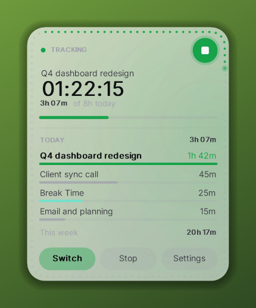
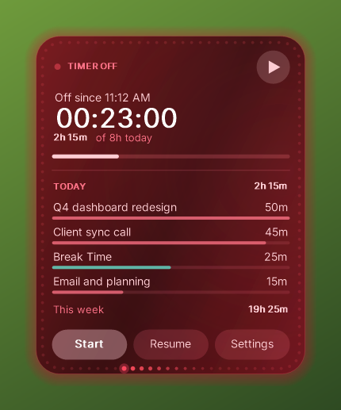
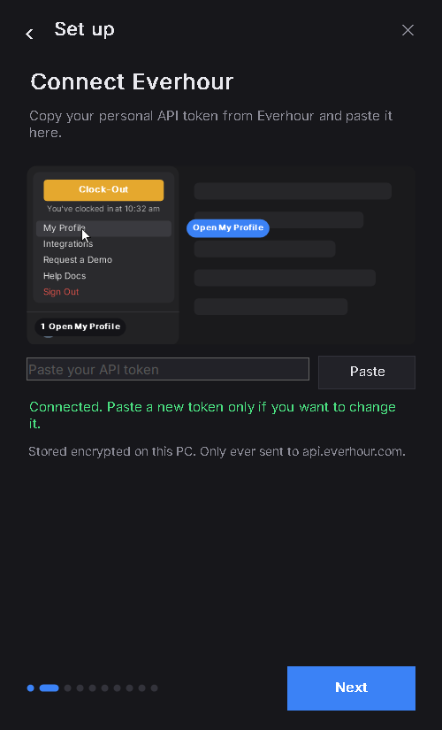
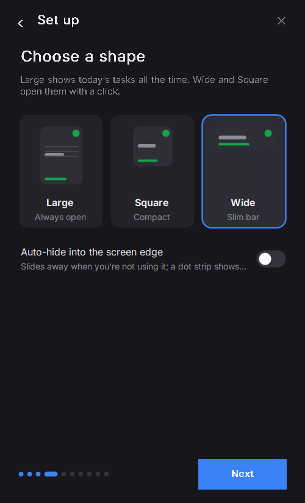
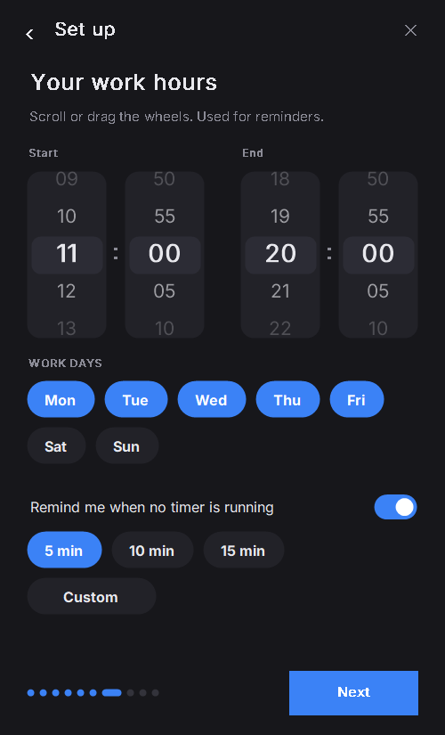
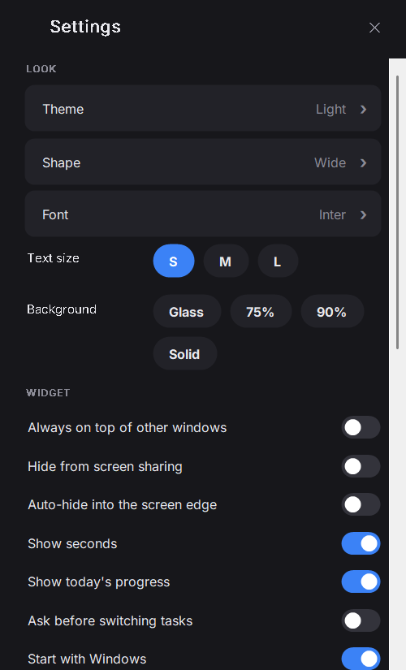

# Everhour Widget

A modern desktop widget for Windows that shows the [Everhour](https://everhour.com) timer you're running — live, always on your desktop, styled like an iPhone / Android home-screen widget. Start, stop and switch tasks without opening the browser.

No admin rights. One PowerShell script, a few launchers and some open-source fonts.

<p>
  
  
</p>

## It changes with what you're doing

| | |
| --- | --- |
|  | **Working** — your theme. The dots round the edge fill up once a minute, Nothing-phone style. |
|  | **On a break** — calm teal gradient with a steaming cup. The bar shows how much of today's break allowance is used. |
|  | **Break over the limit** — fast red-orange gradient, chasing lights and warning stripes. |
|  | **No timer running** — the whole widget turns red, a red dot circles the edge, and the timer counts how long you've been off. |

A task counts as a break when its name contains words you choose (e.g. "break", "lunch"); the allowance is 1 hour a day by default.

## Three shapes, plus auto-hide

| Large (default) | Square | Wide |
| --- | --- | --- |
|  |  |  |
| Always shows today's tasks | Compact; click to open the list | Slim bar; click to open the list |

**Auto-hide** slides the widget into the nearest screen edge when you're not using it. A slim dot strip stays visible and keeps showing the status (working, break, red) — hover it and the widget slides back.


Whatever the shape, the widget never goes off screen: opening it near an edge makes it grow the other way.

## Features

- **Edge lights** — a dot-matrix ring that tracks seconds, breaks and idle time
- **One-click start / stop** — the round button resumes your last task
- **Task picker** — recent tasks, live search, an optional note, confirm before switching
- **Global shortcut** — `Ctrl+Alt+E` starts or stops the timer from anywhere
- **Hidden from screen sharing** — Teams, Zoom, Meet and screenshots don't see it
- **Modern fonts** — Inter (iPhone style), Doto (Nothing dot-matrix), Space Grotesk, Geist, Poppins, Manrope, Outfit, Sora and more
- **Themes** — Graphite, Ocean, Midnight, Forest, Sunset, Light
- **Never freezes** — Everhour calls run in the background; offline shows a tag and keeps counting
- **Silent start** — no console windows flash at login
- **High-DPI and multi-monitor** aware; API token stored encrypted (Windows DPAPI)

## Setup: one question at a time

On first run the widget asks a short series of questions, like setting up a new phone — connect your account (with an animation showing where the API token is), then theme, shape, font, size, work hours, breaks and daily target — and ends with **Start tracking**. Every answer saves on its own and shows on the widget straight away.

<p>
  
  
  
</p>

## Settings

Right-click → **Settings**. A compact list: look (theme, shape, font, text size S/M/L, background), widget switches, focus and breaks, work hours, an **Advanced** page (daily target, refresh, auto-collapse, keyboard shortcut) and your account at the bottom. No Save button — changes apply and save instantly.



## Install

1. Download this repository (Code → Download ZIP) and unzip it.
2. Double-click **`Install Everhour Widget.vbs`** (if Windows asks, click *Open*).
3. Answer the setup questions.

It installs to `%LOCALAPPDATA%\Programs\EverhourWidget` for your Windows user, starts automatically at login, and keeps working if you delete the download. To run it in place instead, use **`Start Everhour Widget.vbs`**.

### Share it with someone

Run **`Build Share Folder.bat`**. It creates `Share\Everhour Widget` and `Share\Everhour Widget.zip` — send either. Your token is never included.

## Using it

| Action | What it does |
| --- | --- |
| Round button | Start / stop (resumes your last task) |
| Click the widget | Open / close today's list (Wide and Square) |
| Drag | Move it — position is remembered |
| Right-click | Start, resume, stop, refresh, change shape, settings, setup guide, exit |
| `Ctrl+Alt+E` | Start / stop from anywhere |

## Files

| File | Purpose |
| --- | --- |
| `EverhourWidget.ps1` | The widget |
| `Install Everhour Widget.vbs` | Installs for this user and starts it |
| `Start Everhour Widget.vbs` | Runs it from this folder |
| `Build Share Folder.bat` | Makes a folder + zip to give to others |
| `Stop Widget.bat` | Closes it for this session |
| `Test Autostart Now.bat` | Proves it will start at login — no reboot needed |
| `Troubleshoot.bat` | Checks the PC, autostart and your token; writes `troubleshoot-log.txt` |
| `fonts/` | Open-source fonts (SIL OFL 1.1), loaded privately |

Settings and the encrypted token live in `%APPDATA%\EverhourWidget\config.json`; errors go to `error.log` in the same folder.

## Requirements

Windows 10 (2004 or later) or Windows 11, with Windows PowerShell 5.1 (built in).

## For developers

```powershell
# Draw sample images of every widget state, the edge strip and every settings page, then exit
powershell -NoProfile -ExecutionPolicy Bypass -File .\EverhourWidget.ps1 -RenderPreview .\preview
```
