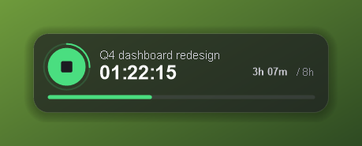
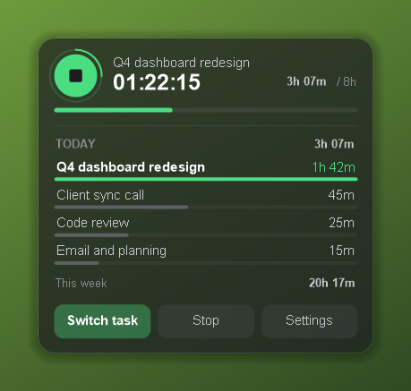
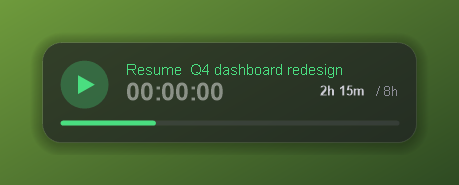
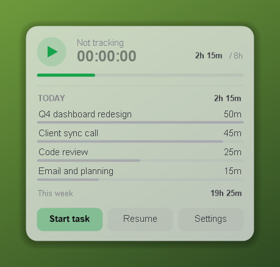
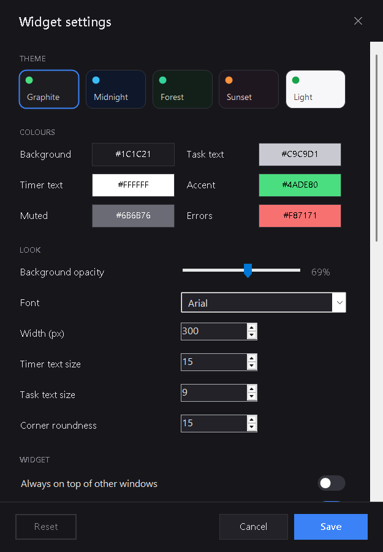

# Everhour Widget

A small, modern desktop widget for Windows that shows the [Everhour](https://everhour.com) timer you're running — live, always on your desktop. Start, stop and switch tasks without opening the browser.

No install, no admin rights: it's one PowerShell script plus a few launchers.

<p>
  
  
</p>

## Features

- **Live timer** with the task name, a seconds ring and today's progress towards your daily target
- **One-click start / stop** — the round button resumes the last task you tracked
- **Expanded view** — today's time per task, this week's total, and Start / Stop / Settings buttons
- **Task picker** — your recent tasks, live search across all tasks, and an optional note for the entry
- **Global shortcut** — `Ctrl+Alt+E` starts or stops the timer from anywhere (configurable)
- **Themes** — Graphite, Midnight, Forest, Sunset and Light, or pick every colour yourself
- **See-through background** with soft shadow and smooth rounded corners; text stays sharp
- **Reminders** when no timer is running during your work hours and work days
- **Never freezes** — all Everhour calls run in the background; if the connection drops it shows "offline" and keeps counting
- **Works on high-DPI screens and multiple monitors**
- **API key stored encrypted** with Windows DPAPI (only your Windows user can read it)
- Starts with Windows, no taskbar button, and only one copy ever runs

<p>
  
  
</p>

## Getting started

1. Get your Everhour API key: **Everhour → your avatar (top right) → Settings → API**.
2. Double-click **`Start Everhour Widget.vbs`**.
3. Paste the key and press **Connect**.

The widget appears in the bottom-right corner and starts automatically every time you log in.

> Always start it with the `.vbs` file. Double-clicking the `.ps1` directly is blocked by Windows by default.

## Using it

| Action | What it does |
| --- | --- |
| Round button | Start / stop (resumes your last task) |
| Click the widget | Expand / collapse |
| Drag | Move it — position is remembered |
| Right-click | Start, resume, stop, refresh, open Everhour, settings, exit |
| `Ctrl+Alt+E` | Start / stop from anywhere |

## Settings

Right-click → **Settings**. Changes preview live on the widget; **Save** keeps them, **Cancel** reverts.



## Files in this folder

| File | Purpose |
| --- | --- |
| `EverhourWidget.ps1` | The widget |
| `Start Everhour Widget.vbs` | Starts it silently (and sets up autostart) |
| `Stop Widget.bat` | Closes it for this session |
| `Test Autostart Now.bat` | Proves it will start at login — no reboot needed |
| `Troubleshoot.bat` | Checks the PC, autostart and your key; writes `troubleshoot-log.txt` |

Settings and the encrypted key live in `%APPDATA%\EverhourWidget\config.json`; errors are logged to `error.log` in the same folder.

## Privacy

Your key never leaves your PC except in requests to `api.everhour.com`. The widget only reads your own time.

## Requirements

Windows 10 or 11 with Windows PowerShell 5.1 (built in). Smooth rounded corners and transparency need the Win32 helpers the script compiles at start; if a locked-down PC blocks that, it falls back to a plain window.

## For developers

```powershell
# Draw sample images of the widget and its dialogs into a folder, then exit
powershell -NoProfile -ExecutionPolicy Bypass -File .\EverhourWidget.ps1 -RenderPreview .\preview
```
